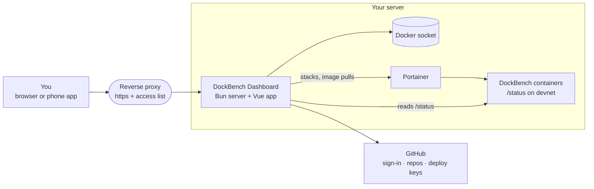

<div align="center">


# DockBench Dashboard

**One screen for all your DockBench dev containers.**

See which container needs you, fix it with a thumb, and deploy a new one from any of your GitHub repositories, from your phone or your desk.

[](https://github.com/Sander972/DockBench-Dashboard/actions/workflows/build.yml)
[](https://github.com/Sander972/DockBench-Dashboard/pkgs/container/dockbench-dashboard)
[](#build-it-yourself)
[](LICENSE)
<br>
[](https://github.com/Sander972/DockBench-Dashboard/commits/main)
[](https://github.com/Sander972/DockBench-Dashboard/issues)
[](#contributing)

[Getting started](#getting-started) · [Configuration](#configuration) · [Security](#security) · [Contributing](#contributing)

</div>

---

## What is it for?

[DockBench](https://github.com/Sander972/DockBench) gives you one dev container per project on a server you own, opened in VS Code through a tunnel. Once you have a few of them, you want to know at a glance which one is stopped, which tunnel is waiting for a login, which repo has unpushed commits, and which container is eating the RAM, without opening Portainer and reading logs.

The dashboard is that glance. It is a single-user web app you host next to your containers: it watches every container labelled `dockbench=true`, tells you what needs attention, and acts on it. It installs as an app on your phone, because that is where you check things.

### What it does

| | |
|---|---|
| 🩺 **Bench** | Every dev container with its state, tunnel, git (branch, dirty files, ahead and behind), CPU, RAM and disk, plus the host totals. Live, refreshed every 2 seconds. |
| 🛠️ **Act on it** | Start, stop, restart, `git fetch`, `git pull`, read the logs, update to a newer image, or purge the container with its volume and deploy keys. |
| 🚀 **Deploy** | Pick one of your GitHub repositories, name the project, done: the dashboard creates a deploy key valid for that repo only and a Portainer stack for the container. |
| 🧑‍💻 **Open it** | Links that open the container in desktop VS Code or `vscode.dev`, including the repo's own `.code-workspace` when it has one. |
| 🤖 **Claude Code** | Choose per container whether Claude Code is installed, inject your `~/.claude` config repo and your VS Code settings, and sign Claude Code in from the dashboard. |
| ✅ **GitHub Actions** | The CI state of your repositories, and of each container's repo on its page. |
| 📜 **Activity** | An audit log of every sign-in and every change. |
| 🔄 **Self-update** | Checks for newer dashboard images and installs them with one button. |
| 💬 **Telegram** | Deploys and sets up the DockBench Telegram bot, which drives Claude Code inside your containers. |

## How it works



- **Reads** come from the Docker socket (containers, stats, disk usage) and from each container's read-only `/status` endpoint on the internal `devnet` network.
- **Deploys and updates** go through Portainer: every dev container is a Portainer stack, so you can still manage it there by hand.
- **GitHub** is used for sign-in, for the list of your repositories and to create the per-repo deploy keys. The GitHub token never leaves the dashboard server.

The server has no runtime dependencies besides Bun, and keeps its state (account, sessions, settings, activity log) as files in one volume.

## Getting started

**You need:**

- a 64-bit ARM Linux server with Docker ([or build the image](#build-it-yourself) for x86), where your [DockBench](https://github.com/Sander972/DockBench) containers run;
- [Portainer CE](https://www.portainer.io) on that server;
- a reverse proxy with https, for example [nginx proxy manager](https://nginxproxymanager.com);
- a GitHub account and an authenticator app (Google Authenticator, 1Password, …).

### 1. Prepare the server (once)

The dashboard joins two external Docker networks: `devnet`, where the dev containers are, and `proxy`, where your reverse proxy reaches it. Create them if DockBench has not already:

```sh
docker network create devnet
docker network create proxy
```

### 2. Create a GitHub OAuth App

On GitHub, **Settings → Developer settings → OAuth Apps → New OAuth App**:

- Homepage URL: the address the dashboard will have, e.g. `https://dock.example.com`;
- Authorization callback URL: `https://dock.example.com/api/auth/github/callback`.

Keep the client id and generate a client secret.

### 3. Get a Portainer access token

In Portainer, **My account → Access tokens → Add access token**. Also note the numeric id of your local Docker environment: it is in the URL of its page under **Environments**.

### 4. Generate the two secrets

```sh
openssl rand -base64 48                                                              # SESSION_SECRET
docker run --rm ghcr.io/sander972/dockbench-dashboard:latest bun server/totp.ts your-github-login   # TOTP_SECRET
```

The second command prints `TOTP_SECRET=…` and an `otpauth://` link. Add the secret to your authenticator app with "Enter a setup key" (time based). Never paste it into an online QR code generator.

### 5. Start it

In Portainer, **Stacks → Add stack**, paste [`docker/compose.yml`](docker/compose.yml) and fill the variables ([see Configuration](#configuration)). Or with plain Compose:

```sh
docker compose -p dockbench-dashboard --env-file dashboard.env -f docker/compose.yml up -d
```

### 6. Put it behind your reverse proxy

Add a proxy host that forwards `dock.example.com` to `dockbench-dashboard` on port `3001` over the `proxy` network. Use https only, turn on HSTS, and attach an access list. The live feed is a plain HTTP stream and asks nginx not to buffer it, so no extra settings are needed.

### 7. Sign in

Open the dashboard, continue with GitHub, then type the 6-digit code from your authenticator. In **Settings** you can add a passkey, which then signs you in by itself and confirms destructive actions.

> [!NOTE]
> The dashboard pulls images through Portainer. Public images need nothing more. For private images, add a `ghcr.io` entry under Portainer's **Registries** with a token that has `read:packages`; the dashboard uses it automatically.

## Configuration

All settings are environment variables, read once at start. A missing required one stops the server with its name. [`.env.example`](.env.example) is the template for local development.

| Variable | Required | What it does |
|---|---|---|
| `PUBLIC_URL` | yes | The dashboard's address, e.g. `https://dock.example.com`. The OAuth callback is `<PUBLIC_URL>/api/auth/github/callback`; `https://` makes the cookies `Secure`. |
| `GITHUB_CLIENT_ID`, `GITHUB_CLIENT_SECRET` | yes | From your GitHub OAuth App. |
| `GITHUB_LOGIN` | yes | The one GitHub login allowed to sign in. |
| `SESSION_SECRET` | yes | Random string of at least 32 characters; signs the session cookies. |
| `TOTP_SECRET` | yes | The authenticator secret from step 4. |
| `PORTAINER_URL` | yes | Portainer as the dashboard container reaches it, e.g. `http://portainer:9000`. |
| `PORTAINER_API_KEY` | yes | Your Portainer access token. |
| `PORTAINER_ENDPOINT_ID` | yes | Numeric id of the local Docker environment in Portainer. |
| `DOCKBENCH_IMAGE` | no | Image for new dev containers. Default `ghcr.io/sander972/dockbench:latest`. |
| `DOCKER_HOST` | no | Default `/var/run/docker.sock`. A `tcp://` or `http://` URL is used as is, for local development. |
| `DATA_DIR` | no | Where the state files live. Default `/data`. |
| `STATIC_DIR` | no | The built frontend. Default `dist`. |
| `PORT` | no | Default `3001`. |

## Security

The dashboard mounts the Docker socket, so whoever controls it controls the server. It is built around that:

- **One user.** Only `GITHUB_LOGIN` can sign in, and only with a second factor: a TOTP code after GitHub, or a passkey instead of both.
- **Device sessions.** Every signed-in device is listed in Settings and can be signed out. Sessions expire when idle and after 30 days at most, and their number is capped.
- **Step-up for destructive actions.** Once you have a passkey, actions like stop, update, deploy or purge ask for it again (each check can be turned off in Settings).
- **Narrow credentials for containers.** The GitHub token stays on the server. Each dev container gets a deploy key valid for its own repository only; signing `gh` in inside the container is an explicit per-deploy choice.
- **No secrets in logs.** Tokens, keys and codes never reach the activity log, the server log or error messages.
- **Same-origin writes.** Every write must come from the dashboard's own origin.
- **Nothing published.** The container publishes no port; it is reachable only through your reverse proxy, which should add https and an access list.

Also worth doing: pin `docker/compose.yml` to an image digest or a tag you bump by hand instead of `:latest`, and protect the `main` branch of your fork if it builds the image you run.

## Build it yourself

The published image is `linux/arm64`. For x86 servers, or to customize it:

```sh
docker buildx build --platform linux/amd64 -f docker/Dockerfile -t dockbench-dashboard:amd64 --load .
```

Then set `image:` in `docker/compose.yml` to your tag. The DockBench image is arm64 too, so on x86 build it as well and point `DOCKBENCH_IMAGE` at it. The included [GitHub Actions workflow](.github/workflows/build.yml) builds the arm64 image on every push to `main`.

## Contributing

You need [Bun](https://bun.sh) and Node 22 (`mise install` reads it from [`.mise.toml`](.mise.toml); the type check needs real Node, not Bun's).

```sh
bun install
cp .env.example .env          # fill the GitHub OAuth App (callback http://localhost:5173/api/auth/github/callback)
bun run server                # API on :3001, reads .env
bun run dev                   # app on :5173, proxies /api to the server
```

There is no mock API on purpose: the app always talks to a real server. Point `DOCKER_HOST` at a Docker daemon (e.g. `tcp://localhost:2375`) to see containers.

Checks to run before a pull request:

```sh
bun run test                  # frontend tests (vitest)
bun run test:server           # server tests (bun test)
bun run typecheck:server
bun run build                 # type check + production build
```

Two rules the code keeps: every new `/api/*` route goes through the `auth` wrapper in `server/routes.ts`, and `server/` has no runtime dependencies.

## License

[MIT](LICENSE)
